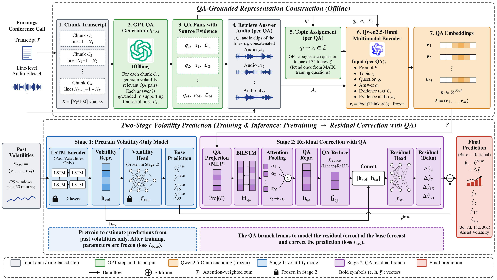

# Beyond Historical Volatility: QA-Grounded Multimodal Residual Correction for Earnings-Call Volatility Forecasting

Code, data and predictions for the paper by Mohammad Hosein Panahi, Ehsan Panahi, Nicoleta Roman and Doina Caragea (IEEE BigData 2026).

An LLM turns each earnings call into **volatility-oriented question–answer (QA) units**, each grounded in the transcript lines that support it and in the audio of those lines. **Qwen2.5-Omni** encodes every QA unit (topic, question, answer, evidence text and evidence audio) into one embedding. A **two-stage model** then forecasts realized volatility at 3, 7, 15 and 30 days: a volatility-only LSTM is pretrained on historical volatility and frozen, and a QA branch learns a **residual correction** to its forecast.



---

## Contents

- [Quick start](#quick-start): our results in Tables I and III in one minute
- [Reproducing the paper](#reproducing-the-paper): four entry points, from the released predictions to the full pipeline
- [What is released, and where](#what-is-released-and-where)
- [Repository layout](#repository-layout)
- [Where each number in the paper comes from](#where-each-number-in-the-paper-comes-from)
- [Data](#data)
- [Configuration](#configuration)
- [Reproducibility notes](#reproducibility-notes)
- [Troubleshooting](#troubleshooting)
- [Local execution, dataset downloads and your own experiments](docs/EXTENDING.md)
- [Citation](#citation) · [License](#license)

---

## Quick start

No GPU, no API key and no extra download are needed, only Python 3 with `numpy`, `pandas` and `scipy`.

```bash
git clone https://github.com/hosein97/ecc-volatility-prediction
cd ecc-volatility-prediction
pip install -r requirements.txt

python scripts/make_tables.py                # Table I (our rows) and Table III
python scripts/sensitivity_and_twosided.py   # common-call sensitivity analysis, pairwise tests
python scripts/confirmatory_bootstrap.py     # confirmatory call-level bootstrap (Holm)
```

The three scripts read the released test predictions in `results/predictions/`, print the tables, and write them as CSV files to `results/tables/`. Together they take under a minute and reproduce our results in Tables I and III and the associated statistical tests: compare the output of `make_tables.py` with the "Ours" rows of Table I and with Table III ([where each number comes from](#where-each-number-in-the-paper-comes-from)).

To score your own run instead of the released predictions, pass notebook 3's output: `python scripts/make_tables.py --maec15 item_losses.csv --maec16 item_losses.csv --ec item_losses.csv --out my_tables`.

---

## Reproducing the paper

The pipeline has three stages, and you can enter at any of them. Each stage's outputs are released, so each entry point starts from the published inputs of that stage.

```
MAEC + EC transcripts and audio
        │  notebook 1  (OpenAI API)
        ▼
QA units + topics            ← released: data package, qa/
        │  notebook 2  (Qwen2.5-Omni, GPU)
        ▼
QA embeddings                ← released: data package, embeddings/
        │  notebook 3  (training, GPU)
        ▼
test predictions             ← released: results/predictions/
        │  scripts/
        ▼
our results in Tables I and III and the associated tests
```

| Entry point | What you run | Needs | Time | Reproduces the paper's numbers |
|---|---|---|---|---|
| **A. Tables from the released predictions** | the three scripts of the [quick start](#quick-start) | Python | 1 minute | exactly |
| **B. Train the models** from the released QA embeddings | notebook 3 | Colab with a GPU (the paper used an L4), data package (`embeddings/`) | several GPU hours | not guaranteed: training can differ across hardware and library versions ([notes](#reproducibility-notes)) |
| **C. Compute the embeddings** from the released QA units | notebooks 2 → 3 | Colab with an A100 GPU, data package (`qa/`) | about 20 GPU hours | not guaranteed: the embeddings depend on the GPU and the library versions ([notes](#reproducibility-notes)) |
| **D. Everything from the raw data** | notebooks 1 → 2 → 3 | Colab (a GPU for notebooks 2 and 3), OpenAI API key (approximately US$50–65, a historical estimate) | 1–2 days | no: new QA units, different numbers |

### Where the notebooks run

The notebooks are designed for Google Colab, where all of the paper's runs were made (notebook 1 on a CPU runtime, notebook 2 on an NVIDIA A100, notebook 3 on an NVIDIA L4). They can also be run on your own machine, as described in [docs/EXTENDING.md](docs/EXTENDING.md#7-running-the-notebooks-on-your-own-machine); local execution was not used for the paper's results, and notebook 2 was run on Colab only.

### Running a notebook on Colab

These steps are the same for the three notebooks.

1. Put the [data package](#data) in your own Google Drive as `My Drive/qa-grounded-volatility/` and check its files against the SHA-256 values in [docs/DATA.md](docs/DATA.md). It has to be a copy in your own Drive, because the notebooks write into the folder (`WORK_DIR` in the settings cell selects another folder). For entry point B this step is optional: notebook 3 can download and verify the embeddings itself. Entry point D needs no data package.

```
My Drive/qa-grounded-volatility/
├── qa/               9 files   input of notebook 2    (not needed for entry point B)
├── embeddings/      19 files   input of notebook 3    (written by notebook 2 in entry point C)
├── qa_generated/               created by notebook 1  (new QA units; `qa/` is not touched)
├── pipeline_work/              created by notebook 1  (intermediate files)
└── results/                    created by notebook 3  (item_losses.csv, tables/)
```

2. Open the notebook with its "Open in Colab" badge below and choose the runtime given there.
3. Edit the settings cell, the only cell to edit, and run all cells. Run `RUN_MODE = "smoke"` first: it tests your setup and ends with `SMOKE TEST PASSED`. The test modes (`"smoke"`, `"mini"`, `"check"`) write to their own folders, named after the mode, never to the folders above.

### B. Train the models from the released embeddings (notebook 3)

[](https://colab.research.google.com/github/hosein97/ecc-volatility-prediction/blob/main/notebooks/3_volatility_prediction.ipynb)

GPU runtime (the paper used an L4). The notebook needs the 19 embedding files in `embeddings/`: with `DOWNLOAD_PUBLIC_DATA = True` in the settings cell it downloads them (about 0.9 GB), checks each against its SHA-256 and never replaces a file that is already there; otherwise copy them from the data package.

| `RUN_MODE` | What it does | Time |
|---|---|---|
| `"smoke"` | Tests your setup: runs every cell with 2 seeds and 2 epochs. The numbers are meaningless. Ends with `SMOKE TEST PASSED`. | minutes |
| `"check"` | Trains 3 of the paper's seeds in full and compares every prediction with the released one. By default the proposed model is trained on MAEC-15 only; set `CHECK_DATASETS = ["maec15", "maec16", "ec"]` in the settings cell for all three datasets. | about 15 minutes on a GPU with the defaults |
| `"full"` (default) | The paper's run: trains the 12 models of Tables I and III (Past Volatility on the 3 datasets and 9 QA-based models) with 55 seeds each. | several GPU hours |

The full run writes every test prediction to `results/item_losses.csv` and our rows of Table I and Table III to `results/tables/`. An interrupted run starts again from the beginning.

### C. Compute the embeddings from the released QA units (notebook 2)

[](https://colab.research.google.com/github/hosein97/ecc-volatility-prediction/blob/main/notebooks/2_qa_embeddings.ipynb)

A100 GPU runtime (about 15–20 hours for the five variants). The notebook needs the data package's `qa/` folder and downloads the MAEC and EC audio. Continue with B.

| `RUN_MODE` | What it does |
|---|---|
| `"smoke"` | Tests your setup: runs every cell on the first 2 transcript chunks of each split. It still downloads the audio and the model. Ends with `SMOKE TEST PASSED`. |
| `"full"` (default) | The paper's run: every QA unit of every split, five variants. |

The notebook writes the five embedding variants of every split to `embeddings/` (35 files, of which notebook 3 reads the 19 the paper uses) and, in section F, attaches ticker and date to every record; notebook 3 refuses files without them. Each file is saved when its split is finished; an interrupted run loses the split in progress. If you compute one variant only, keep the data package's files for the others in that folder; section F saves every file again, so they keep their content but no longer match the released checksums, and notebook 3 then reports them as not identical to the released files.

### D. Everything from the raw data (notebook 1)

[](https://colab.research.google.com/github/hosein97/ecc-volatility-prediction/blob/main/notebooks/1_qa_generation.ipynb)

CPU runtime. Give your OpenAI API key as the Colab secret `OPENAI_API_KEY`. Continue with C, with `QA_DIR` in notebook 2's settings cell set to `/content/drive/MyDrive/qa-grounded-volatility/qa_generated`.

| `RUN_MODE` | What it does | Cost |
|---|---|---|
| `"smoke"` | Tests your setup: downloads the data, builds the transcripts, the chunks and the first request file, checks your API key and its access to the four models, then stops before the first paid request with `SMOKE TEST PASSED`. The paid steps are not run and not tested. | none |
| `"mini"` | Tests every cell, including the paid ones, on a small number of calls (by default 60 training, 5 validation and 5 test calls of each MAEC year, and 10 EC calls). It writes to `qa_generated_mini/`; these QA units and topics are a test output. | a small fraction of the full cost; not measured |
| `"full"` (default) | The paper's pipeline, including the paid OpenAI requests in the cells marked 💲 (QA generation, preliminary topic labels, label embeddings, cluster names, topic assignment). | approximately US$50–65 (historical estimate) |

The MAEC QA generation, the dominant paid step, cost approximately US$50 in the original configuration; US$50–65 is a historical estimate for the complete workflow, not a guaranteed current price. The notebook writes to `qa_generated/`, not to `qa/`, and a full run stops at the start if its output folder already holds QA files, so the released QA units are not replaced. Each paid cell sends its requests as an OpenAI batch job and waits until the job is finished (up to 24 hours; the label embeddings are a direct request); a cell that is interrupted while it waits sends, and pays for, its requests again when it is run again.

GPT outputs are not deterministic, so a new run produces different QA units and different numbers. That is why the QA units used in the paper are released, and why all of the paper's experiments use them.

---

## What is released, and where

| What | Where | Size |
|---|---|---|
| Code: three notebooks (the full pipeline) and four scripts | this repository | small |
| Prompts for QA generation, topic discovery and the five Qwen encodings | inside notebooks 1 and 2 | |
| Every test prediction behind our results in Tables I and III (55 seeds) | `results/predictions/` | 11 MB |
| Recomputed EC inputs and the prices they are computed from | `data/ec/` | 0.2 MB |
| Seed list, OpenAI model snapshots, Qwen revision, layer sizes, package versions | [Configuration](#configuration) | |
| Generated QA units, the 35 topics, the call map | data package, `qa/` | 48 MB |
| QA embeddings: the 19 files the paper's models use | data package, `embeddings/` | about 0.9 GB |
| MAEC and EC transcripts and audio; KeFVP volatility files | third-party; the notebooks download them | about 24 GB of archives |

**Data package (Google Drive): <https://drive.google.com/drive/folders/1LOMRqqFQrA-Oz4n6GBDxlLWOfPE8VxZp>**

The repository alone reproduces our results in Tables I and III and the associated statistical tests from the released predictions. The data package is needed only to retrain the models or recompute the embeddings.

---

## Repository layout

```
ecc-volatility-prediction/
├── notebooks/                          run in this order
│   ├── 1_qa_generation.ipynb           transcripts → chunks → GPT QA units → topics → QA files      (CPU, OpenAI API)
│   ├── 2_qa_embeddings.ipynb           QA files → Qwen2.5-Omni embeddings (5 variants)              (GPU)
│   └── 3_volatility_prediction.ipynb   embeddings + volatility labels → models → predictions → tables (GPU)
├── scripts/
│   ├── make_tables.py                  predictions → Table I (our rows) and Table III, with the t-tests
│   ├── sensitivity_and_twosided.py     predictions → common-call analysis and pairwise tests quoted in the text
│   ├── confirmatory_bootstrap.py       predictions → the confirmatory call-level bootstrap on MAEC-16 (Holm)
│   └── build_ec_features.py            adjusted closes → recomputed EC historical-volatility features
├── data/ec/
│   ├── ec_test_corrected.csv           EC test calls (110) with the recomputed features; read by notebook 3
│   ├── ec_adjusted_closes.csv          daily adjusted closes used to compute them
│   └── ec_adjusted_closes_supplement.csv   Yahoo Finance adjusted closes for six calls
├── results/
│   ├── predictions/                    every test prediction behind our results in Tables I and III (55 seeds)
│   └── tables/                         written by the scripts (not tracked)
├── docs/
│   ├── DATA.md                         data sources, the data package, file formats, checksums
│   ├── EXTENDING.md                    local execution, dataset downloads, your own experiments
│   └── architecture.png
├── legacy/                             earlier development notebooks, kept for reference
├── requirements.txt                    for the scripts (the notebooks install their own packages on Colab)
├── requirements-qa.txt                 for notebook 1 outside Colab
├── requirements-embeddings.txt         for notebook 2 outside Colab
├── requirements-training.txt           for notebook 3 outside Colab
├── CITATION.cff
└── LICENSE
```

---

## Where each number in the paper comes from

| In the paper | Produced by | Output |
|---|---|---|
| Table I, rows "Ours" (and the `**` marks) | `scripts/make_tables.py` | `results/tables/table1_ours.csv` |
| Table I, baseline rows | published values, as cited in the paper | none |
| Table II (AutoNation example) | notebook 1 | data package, `qa/kefvp_train_maec15_…json` |
| Table III (MAEC-16 ablation, with marks) | `scripts/make_tables.py` | `results/tables/table3_ablation_maec16.csv` |
| Confirmatory analysis (bootstrap, Holm) | `scripts/confirmatory_bootstrap.py` | `results/tables/maec16_confirmatory*.csv` |
| RQ2 and RQ3: pairwise tests, per-horizon reductions, spread | `scripts/sensitivity_and_twosided.py` | `results/tables/maec16_pairwise_ttests.csv` (the tests); the reductions and the spread are printed |
| Sensitivity to the fallback (common calls) | `scripts/sensitivity_and_twosided.py` | `results/tables/populations_all_vs_common.csv` |
| Test predictions of all 12 models | notebook 3 | `results/predictions/*.csv.gz` |
| EC inputs recomputed with the MAEC definition | `scripts/build_ec_features.py` | `data/ec/ec_test_corrected.csv` |
| The 35 topics; silhouette sweep over k | notebook 1, section 4 | data package, `qa/kefvp_train_maec_35clusters.json` |
| Numbers of QA units per dataset, call and chunk (Section V-A) | counted from the QA files ([docs/DATA.md](docs/DATA.md) gives the format) | data package, `qa/` |
| Prompts (QA generation, topics, Volatility and General Prompt, ablation prompts) | notebooks 1 and 2 | |
| Seeds, model snapshots, Qwen revision | [Configuration](#configuration) | |

The remaining descriptive figures of the paper have no script in this repository: the audio durations per QA unit and per call, the share of chunks and QA units longer than 300 s, the automatic check of the figures in the generated answers, and the share of EC test firms that also appear in the MAEC training data. They can be computed from the QA files, the MAEC and EC audio, and the KeFVP split files.

---

## Data

| Source | Used for | Where it comes from |
|---|---|---|
| **MAEC** (Li et al., CIKM 2020): MAEC-15 and MAEC-16 transcripts with line-level audio | QA generation, audio | downloaded by notebooks 1 and 2 |
| **EC** (Qin & Yang, ACL 2019): transcripts with line-level audio | QA generation, audio | downloaded by notebooks 1 and 2 |
| **KeFVP volatility files** (Niu et al., Findings of EMNLP 2023): splits, targets, MAEC historical features | labels, splits, inputs | downloaded from GitHub (commit `95993892`) |
| **Adjusted closing prices** for the EC test calls | recomputed EC features | `data/ec/` |
| **Data package**: our QA units, topics, call map and QA embeddings | entry points B and C | [Google Drive folder](https://drive.google.com/drive/folders/1LOMRqqFQrA-Oz4n6GBDxlLWOfPE8VxZp) |

The data package (about 0.9 GB) contains `qa/` (the QA units of every split, the 35 topics, `call_map.json`) and `embeddings/` (19 embedding files: the Volatility Prompt embeddings of all 7 splits, and the four ablation variants of the 3 MAEC-16 splits). [docs/DATA.md](docs/DATA.md) lists every file with its SHA-256 and describes the formats. The QA files quote transcript text from MAEC and EC; use them under those datasets' terms.

A few test calls are not scored or have no QA units (paper, Section V-A). On a call without QA units, every QA-based model uses the same seed's Past Volatility prediction.

### The recomputed EC inputs

`data/ec/ec_test_corrected.csv` holds the EC test inputs recomputed with the MAEC definition (paper, Section IV-B); the EC targets are unchanged. `python scripts/build_ec_features.py` rebuilds the file byte for byte from `data/ec/ec_adjusted_closes*.csv` and the KeFVP EC test file, which it downloads ([docs/DATA.md](docs/DATA.md) gives the definition and the price sources).

---

## Configuration

The paper gives the method and the training settings (Sections IV and V-C); the splits are in [docs/DATA.md](docs/DATA.md). This section lists what the paper refers to the repository for, and the implementation details it does not state.

| | |
|---|---|
| OpenAI models | notebook 1 calls `gpt-5`, `gpt-5.2` and `gpt-5-mini`; for the paper's runs these were the snapshots `gpt-5-2025-08-07`, `gpt-5.2-2025-12-11` and `gpt-5-mini-2025-08-07`. It also calls `text-embedding-3-large` for the label embeddings |
| Qwen | Qwen2.5-Omni-7B, revision `ae9e169`; `transformers` 5.20.1 and `bitsandbytes` 0.50.2 (pinned in notebook 2); the embeddings were computed on an NVIDIA A100 |
| Model | 2-layer LSTM (64) + head 64→128→64→4 (frozen in stage 2) · QA projection 3584→512→256, BiLSTM 128×2, additive attention (masked), reduction 256→64, residual head 128→64→4 (last layer zero-initialised) · dropout 0.2 |
| Training environment | PyTorch 2.11 (CUDA 13.0) on an NVIDIA L4 |
| Seeds | 1, 3, 5, 6, 9, 11, 13, 14, 15, 17, 18, 19, 21, 23, 24, 26, 28, 30, 31, 32, 33, 34, 35, 39, 40, 42, 43, 44, 45, 46, 48, 50, 53, 59, 60, 61, 63, 64, 65, 66, 67, 69, 71, 73, 76, 80, 81, 83, 87, 88, 89, 93, 94, 96, 98 |

---

## Reproducibility notes

- **Entry point A is exact.** The scripts are deterministic (the bootstrap uses a fixed random seed) and reproduce every value of our rows in Table I and of Table III, and every test quoted in the paper.
- **Training (B) is not guaranteed to reproduce the released predictions.** The paper's runs used an NVIDIA L4 on Colab with PyTorch 2.11. GPU training can differ across hardware and library versions, and a complete retraining of all configurations and seeds was not verified against the released predictions. `check` mode trains a few of the paper's seeds on your setup and compares every prediction with the released one. Differences between complete training runs can be of the same order as the smallest effects in Table III (the modality and prompt comparisons); the paper discusses this. The released predictions are the exact record of the paper's numbers.
- **Embeddings (C) are not guaranteed to reproduce the released files.** They depend on the GPU, the quantization library, the Qwen revision and, slightly, on the other units in a batch. The released embeddings were computed on a Colab NVIDIA A100 with the pinned versions: use the same to reproduce them. On a GPU with less memory (for example an NVIDIA L4, 22 GB) the embeddings can differ slightly and a run can stop for lack of memory. A complete regeneration was not verified against the released files, and the effect of small embedding differences on the final numbers was not tested. The released embeddings are the ones behind the paper's numbers.
- **QA generation (D) is nondeterministic.** The OpenAI models are proprietary and versioned. Use the released QA units to reproduce the paper.
- **Targets and features are used as released** by KeFVP (pinned commit), except for the EC historical features, which are recomputed ([Data](#the-recomputed-ec-inputs)).

---

## Troubleshooting

- **`FileNotFoundError` for a `kefvp_….pkl` or `….json` file:** the data package is not where the notebook expects it. Check the Drive layout above and the folders in the notebook's settings cell; notebooks 2 and 3 list the missing files. For notebook 3, `DOWNLOAD_PUBLIC_DATA = True` in the settings cell downloads the missing embedding files.
- **Notebook 3 stops with "embedding files without ticker/date":** the embeddings were written by notebook 2 without section F. Run that section's cell.
- **The MAEC or EC download fails in Colab:** these are third-party files on Google Drive, which can refuse downloads of popular files for up to 24 hours. Try again later, or see [docs/EXTENDING.md](docs/EXTENDING.md#8-dataset-downloads-on-colab) for a route around the refusal and for keeping the archives on your Drive (`ARCHIVE_DIR`).
- **A QA unit cannot be embedded in notebook 2:** the notebook lists it (`[unit skipped]`) and continues. A few released QA units have an unusable evidence span and have no embedding in the variants that use the cited lines ([docs/DATA.md](docs/DATA.md)).

---

## Citation

```bibtex
@inproceedings{panahi2026qagrounded,
  title     = {Beyond Historical Volatility: {QA}-Grounded Multimodal Residual Correction for Earnings-Call Volatility Forecasting},
  author    = {Panahi, Mohammad Hosein and Panahi, Ehsan and Roman, Nicoleta and Caragea, Doina},
  booktitle = {Proceedings of the IEEE International Conference on Big Data},
  year      = {2026}
}
```

## License

The MIT license (see [LICENSE](LICENSE)) applies to our original code: the notebooks and the scripts. It does not apply to the data in `data/`, to the data package, or to the third-party datasets, which are subject to their own licenses and terms ([docs/DATA.md](docs/DATA.md), section 4).
